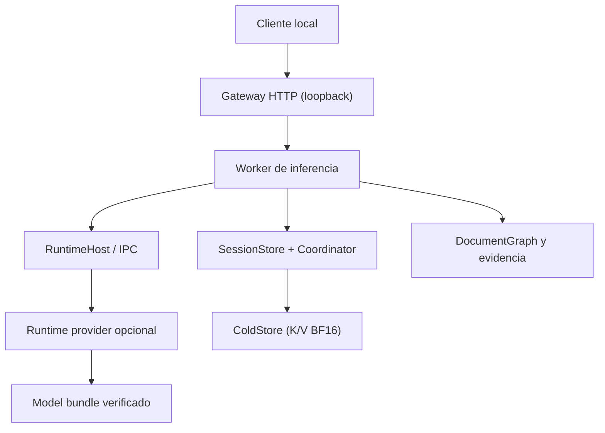
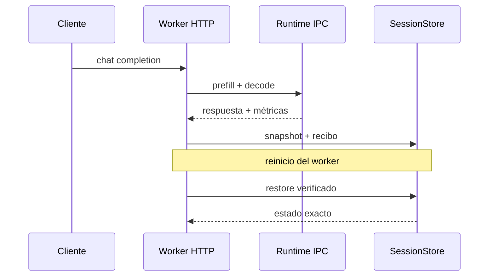

<h1 align="center">VKSLIM</h1>

<p align="center">
  <strong>Contexto verificable, continuidad persistente y ejecución local para LLMs.</strong><br>
  Un núcleo Rust backend-neutral que conserva el estado K/V exacto, recupera evidencia original y solo activa un runtime cuando sus capacidades han sido comprobadas.
</p>

<p align="center">
  <a href="https://github.com/sheilyneural-afk/VK-SHEI/actions/workflows/kvslim.yml"></a>
  <a href="https://www.rust-lang.org/"></a>
  
  
</p>

> [!IMPORTANT]
> **Estado real:** KVSLIM no es una maqueta ni una simulación. El bundle y el host de referencia tienen certificación funcional pasada: inspección, carga, prefill, decode, snapshot K/V, restore y continuidad HTTP tras reinicio. El README separa esos resultados demostrados de las propiedades que todavía no están certificadas fuera de ese entorno.

## Evidencia ejecutada

El proyecto **sí está probado** en un bundle y una máquina de referencia. Estos resultados están guardados dentro de `deploy/local-production/runtime/`:

| Evidencia | Resultado observado |
|---|---|
| `physical-certification.json` *(artefacto local no versionado)* | **PASSED**: `inspect`, `load`, `prefill`, `decode`, `kv_snapshot` y `kv_restore` completados con `exit_code: 0`. Bundle `43e8fa46…d3d686`, adapter `opencl-runtime`, dispositivo AMD Radeon Graphics/OpenCL, host x86_64 con 16 hilos y 64 GB de RAM. |
| `runtime/calibration/*.json` *(artefactos locales)* | Ejecución básica medida: 286,553 µs de prefill, 244,447 µs de decode y snapshot K/V de 210 bytes para la muestra calibrada. |
| `runtime/validation/external-e2e/.../generation.json` *(artefacto local)* | Ruta real proveedor → IPC → worker HTTP: respuesta `"(S"`, 16 tokens de prompt, 1 token de completion, 103.558 s de pared, 52.644 s de prefill y 50.897 s de decode. |
| `runtime/validation/external-e2e/.../resume.json` *(artefacto local)* | Tras reiniciar el worker, la sesión se reanudó con modo `exact` y `restored_bytes: 351`; el recibo y los digests de modelo/tokenizer fueron aceptados. |
| `runtime/validation/adapter-parity-*.json` *(artefacto local)* | Los 8 tokens greedy coincidieron con CPU, pero los logits no quedaron dentro de una ULP BF16 (`max_abs_difference` hasta `0.8125`); por eso el gate marca `blocked-fallback-required`. |

La conclusión correcta es: **el flujo funcional de inferencia, memoria, snapshot, reinicio y recuperación está demostrado en el entorno certificado**. Lo que todavía no se puede afirmar es la paridad numérica bit-exacta del acelerador ni la misma velocidad en cualquier hardware/modelo.

## Qué es

KV-SHEI es el repositorio del runtime **KVSLIM**: una base local para organizar contexto, almacenar estado K/V y conectar runtimes de inferencia mediante contratos verificables.

El núcleo está diseñado alrededor de cuatro ideas:

- **K/V autoritativo en BF16.** El estado exacto se conserva en páginas append-only de `ColdStore`; el índice de 4 bits localiza coordenadas reversibles, pero no sustituye al K/V original.
- **Continuidad con identidad.** Las sesiones semánticas y los snapshots físicos se asocian a generación, hashes, identidad del modelo y recibos explícitos.
- **Selección por capacidades.** El runtime se descubre por las operaciones que demuestra (`prefill`, `decode`, reset, snapshot y restore), no por el nombre de una marca.
- **Evidencia original.** El grafo documental enruta páginas mediante micro-metadatos y enlaces deterministas, pero devuelve el texto original con su digest; no lo reemplaza por un resumen inventado.

## Arquitectura en una vista





El flujo importante es deliberadamente explícito: un catálogo puede encontrar una implementación compilada, pero solo el sondeo local y la inspección del bundle pueden marcarla como utilizable. Si una capacidad no está demostrada, la selección falla de forma cerrada; no hay fallback silencioso que finja compatibilidad.

## Capacidades implementadas

| Área | Qué existe realmente | Fuente principal |
|---|---|---|
| Almacenamiento K/V | `ColdStore` append-only, páginas, lecturas selectivas, auditoría, reapertura de solo lectura y detección de corrupción | [`src/cold_store.rs`](src/cold_store.rs) |
| Continuidad semántica | `SessionStore` con generaciones, hashes de estado, `CURRENT` atómico y rechazo de replay divergente | [`src/session_store.rs`](src/session_store.rs) |
| Continuidad física | `SessionCoordinator` expone snapshot/restore de la KV del runtime y separa esa responsabilidad de la memoria semántica | [`src/session_coordinator.rs`](src/session_coordinator.rs) |
| Contrato de runtime | Manifests, capacidades, selección por probe, handles de tensor y protocolo IPC versionado | [`src/generic_runtime.rs`](src/generic_runtime.rs), [`src/runtime_host.rs`](src/runtime_host.rs) |
| Contrato de adaptadores | `ModelAdapter`, `RuntimeSession`, generación, reset, snapshot, restore y recibos verificables | [`crates/kvslim-adapter-api/src/lib.rs`](crates/kvslim-adapter-api/src/lib.rs) |
| Model bundles | Validación de `config.json`, tokenizer, shards SafeTensors, geometría, nombres, dtypes físicos y layout del decoder | [`src/model_bundle.rs`](src/model_bundle.rs) |
| Catálogo y selección | Inventario efímero del host; diferencia entre compilado, disponible, no disponible y pendiente de probe | [`src/adapter_catalog.rs`](src/adapter_catalog.rs) |
| Grafo documental | Páginas originales, `PageMicroMetadata`, spans, números, referencias explícitas, vecinos y recuperación acotada | [`src/document_graph.rs`](src/document_graph.rs) |
| Recuperación con evidencia | Modos `focused` y `exhaustive`, candidatos diferidos y marca explícita de cobertura no exhaustiva | [`src/document_graph.rs`](src/document_graph.rs) |
| LOD y certificados | Ruta densa exacta cuando `epsilon = 0`; rutas aproximadas solo cuando el certificado autoriza el descarte | [`src/gpu_canonical_lod.rs`](src/gpu_canonical_lod.rs), [`src/attention_certificate.rs`](src/attention_certificate.rs) |
| Servicio local | Worker en loopback, gateway, endpoints de salud/capacidades/modelos y subconjunto HTTP compatible con OpenAI | [`src/bin/kvslim-runtime-worker.rs`](src/bin/kvslim-runtime-worker.rs), [`src/bin/kvslim-gateway.rs`](src/bin/kvslim-gateway.rs) |

## Qué ha logrado realmente

KVSLIM ya ha demostrado en ejecución real, no en mocks:

- cargar un bundle de modelo y validarlo antes de activarlo;
- ejecutar prefill y decode sobre el runtime acelerado;
- conservar K/V físico en ColdStore y emitir recibos con identidad y digest;
- aceptar una petición HTTP y devolver una respuesta del modelo;
- crear un snapshot de sesión, reiniciar el worker y restaurar 351 bytes de estado exactos;
- reanudar la continuidad con el mismo modelo y tokenizer;
- mantener iguales los 8 tokens greedy frente a CPU en la prueba de paridad;
- recuperar documentos mediante micro-metadatos sin sustituir el texto original.

### Límites de lo certificado

Estos límites no borran los logros anteriores; indican exactamente hasta dónde llega la evidencia disponible:

- La paridad numérica bit-exacta de logits del acelerador no pasó: los tokens coincidieron, pero hubo diferencias de hasta 0.8125 y el gate exige fallback.
- Los tiempos medidos pertenecen al bundle, configuración y host de referencia; no son una promesa para otra máquina.
- El worker HTTP actual declara `stream: false`, `tools: false` y `sampling: false`.
- El worker directo debe permanecer en loopback; el gateway separado proporciona autenticación bearer.
- Los drivers del sistema y los adaptadores concretos dependen del entorno donde se instalen.

## Invariantes de integridad

1. **El K/V original es la autoridad.** Las estructuras de micro-regiones, LSH y LOD sirven para localizar o certificar; no son una segunda verdad de baja precisión.
2. **La identidad se ata a hashes.** Modelo, tokenizer, arquitectura, prefijo, generación y snapshot se comprueban antes de restaurar.
3. **Las operaciones incompatibles fallan cerradas.** Un backend no puede ganar por prioridad si solo está compilado o pendiente de probe.
4. **El modelo activo es inmutable durante la ejecución.** Se selecciona por digest dentro de `deploy/local-production/runtime/models/` y se abre en modo de lectura.
5. **La evidencia no se sustituye.** El router documental conserva bytes originales y sus SHA-256; si el presupuesto difiere páginas candidatas, lo comunica.

## Backends y features de Cargo

El contrato público es neutral; las implementaciones concretas se compilan de forma optativa. La siguiente tabla refleja `Cargo.toml`, no una promesa de disponibilidad en el equipo actual.

| Feature | Superficie que compila | Estado real |
|---|---|---|
| `native-cpu-backend` (por defecto) | Runtime CPU Rust portable + bundles de modelo | Disponible cuando el bundle pasa la inspección; la arquitectura concreta sigue siendo una decisión del adapter |
| `torch-backend` | Runtime CPU basado en LibTorch y bins HTTP/CLI asociados | Opcional; requiere LibTorch y sus librerías externas |
| `accelerator-backend` | Worker acelerado, kernels y adapter concreto del árbol `opencl_*` | Opcional; requiere runtime/dispositivo compatible y probe físico |
| `hip-backend` | Bridge nativo hipBLASLt cargado explícitamente | Opcional; hardware y artefacto externos |
| `unified-router` | Gateway HTTP que no carga pesos | Opcional; necesita que exista un worker certificado |
| `model-catalog` | Descubrimiento de candidatos (Hugging Face) | Opcional; no autoriza por sí solo la ejecución |

La implementación actual conserva nombres concretos en la frontera de compatibilidad (`opencl_adapter`, `torch_adapter`, bridge HIP). El **núcleo** no selecciona por esos nombres: trabaja con `AdapterDescriptor`, `AdapterStatus`, `RuntimeManifest` y capacidades probadas. Esa es la separación que permite añadir otra implementación sin cambiar el contrato de sesiones.

## Ciclo de vida de un modelo

```text
descubrir candidato (opcional)
        ↓
importar dentro de runtime/models/<digest>
        ↓
validar configuración, tokenizer, shards y dtypes físicos
        ↓
inspeccionar el adapter y sondear el host
        ↓
certificar paridad, KV y reinicio cuando corresponda
        ↓
activar solo el runtime marcado RuntimeAvailable
```

Un modelo que solo puede inspeccionarse no se anuncia como ejecutable. Para modelos privados, el token de catálogo es de lectura y se guarda dentro del layout local; el secreto nunca forma parte del repositorio ni de los diagnósticos.

## Inicio rápido: núcleo portable

Desde la raíz del repositorio:

```bash
# Mantiene Cargo, temporales y target incremental dentro del proyecto.
deploy/local-production/scripts/install-layout.sh

# Perfil local; no versionar secretos ni credenciales.
cp deploy/local-production/env.example \
   deploy/local-production/local-production.env

# Compilación y pruebas del núcleo sin un backend opcional.
deploy/local-production/scripts/cargo-local.sh check --locked --no-default-features
deploy/local-production/scripts/cargo-local.sh test --locked --lib --no-default-features

# Smoke test de la referencia CPU y del contrato de inspección.
deploy/local-production/scripts/cargo-local.sh run --locked \
  --no-default-features --bin kvslim-inspect -- --self-test
```

La guía operativa completa está en [`deploy/local-production/README.md`](deploy/local-production/README.md). El wrapper local evita que el proyecto dependa de rutas globales para `CARGO_HOME`, `CARGO_TARGET_DIR` y temporales.

## Documentar y consultar un repositorio o corpus

El binario `kvslim-document` crea un grafo lossless; no genera un resumen que sustituya al original:

```bash
# Construir desde texto paginado.
deploy/local-production/scripts/cargo-local.sh run --locked --bin kvslim-document -- \\
  build-text \\
  --document-id proyecto \\
  --version REVISION_O_DIGEST \\
  --text documento.txt \\
  --output graph.json \\
  --page-characters 4000

# Recuperación determinista con páginas originales y digests.
deploy/local-production/scripts/cargo-local.sh run --locked --bin kvslim-document -- \\
  query \\
  --graph graph.json \\
  --text "¿dónde se valida la continuidad?" \\
  --scope focused \\
  --max-pages 8 \\
  --max-characters 32000 \\
  --graph-hops 1
```

La recuperación puede ser `focused` o `exhaustive`, está limitada por presupuesto y expone páginas candidatas diferidas cuando no puede afirmar cobertura completa. La tokenización exacta sigue perteneciendo al runtime del modelo seleccionado.

## Servicio local y continuidad física

El despliegue local separa responsabilidades:

- **Worker interno:** por defecto `127.0.0.1:8188`; carga el modelo y posee la cola de inferencia.
- **Gateway:** por defecto `127.0.0.1:8088`; autentica con bearer token y habla con un worker certificado.
- **ColdStore / SessionStore:** viven bajo `deploy/local-production/runtime/` y no se mezclan con el checkout del código.


Endpoints expuestos por el worker/gateway actual:

| Endpoint | Uso | Estado |
|---|---|---|
| `GET /health` | proceso, modelo y backend activo | operativo |
| `GET /ready` | disponibilidad del worker | operativo |
| `GET /v1/models` | modelo seleccionado | operativo |
| `GET /v1/capabilities` | capacidades, calibración y políticas KV/LOD | operativo |
| `POST /v1/chat/completions` | generación y operaciones de continuidad | subconjunto compatible; sin streaming/tools/sampling general |
Para una release instalada, la secuencia documentada es:

```bash
deploy/local-production/scripts/verify-release.sh
deploy/local-production/scripts/run-local-worker.sh
deploy/local-production/scripts/run-local-runtime.sh
```

`verify-release.sh` comprueba rutas, digests del binario y del worker, digest del árbol del modelo, permisos de solo lectura, bind loopback y formato de `ColdStore`. El servidor actual no debe exponerse a una red compartida sin una capa de autenticación y transporte adecuada.

El worker puede hablar con un runtime externo mediante un manifest IPC. El manifest debe demostrar como mínimo `prefill`, `decode`, `reset_session`, `snapshot_kv` y `restore_kv`; si falta una de esas capacidades, el arranque se rechaza. El proveedor real que existe hoy se encuentra en [`src/bin/kvslim-runtime-provider.rs`](src/bin/kvslim-runtime-provider.rs) y utiliza el adapter acelerado compilado para ese perfil.

## Pruebas y qué certifican

| Prueba | Qué demuestra | Resultado real |
|---|---|---|
| `cargo test --locked --lib` | Invariantes del núcleo, almacenamiento, contratos y recuperación | Tests del núcleo ejecutables |
| `scripts/e2e-runtime-ipc.sh` | Framing Unix, request IDs, identidad de sesión, generación determinista y restore de KV | E2E IPC determinista |
| `scripts/e2e-worker-external-restart.sh` | Ruta proveedor → IPC → worker HTTP → snapshot → reinicio → restore físico con un bundle local | E2E externo real; restauró 351 bytes exactos |
| `physical-certification.json` | Inspect, load, prefill, decode, snapshot y restore del adapter | `status: passed`, `exit_code: 0` |
| `adapter-parity-*.json` | Comparación CPU/acelerador durante 8 pasos greedy | Tokens iguales; logits no bit-exactos; `blocked-fallback-required` |
| Job CI `load` | Tests manuales del worker de inferencia | No sustituye a la certificación física del bundle |

Los tiempos no son una estimación: están registrados en `generation.json`. En el ensayo externo real, la respuesta fue `"(S"`, con 16 tokens de prompt y 1 token generado; tardó 103,558 s, de los que 52,644 s fueron prefill y 50,897 s decode. Después del reinicio, el worker recuperó 351 bytes de la sesión en modo `exact`. Es una medición real del perfil certificado, no una cifra extrapolada a otros equipos.

## Comandos y binarios principales

Los targets disponibles están declarados en [`Cargo.toml`](Cargo.toml). Entre los más útiles:

- `kvslim-inspect`: inspección de bundle y smoke test CPU; no ejecuta un LLM completo por sí solo.
- `kvslim-models`: enumera bundles bajo el runtime local.
- `kvslim-import-model`: importa y digiere un bundle local (`model-import`).
- `kvslim-validate-model`: valida un bundle con las capacidades de modelo compiladas.
- `kvslim-adapters`: muestra adaptadores compilados y su estado.
- `kvslim-autoconfigure`: calcula un perfil a partir de bundles y capacidades observadas.
- `kvslim-runtime-host`: host IPC genérico; su modo de prueba usa una sesión determinista.
- `kvslim-runtime-provider`: proveedor externo del perfil acelerado actual.
- `kvslim-runtime-worker`: HTTP del worker; requiere `accelerator-backend` en la configuración actual.
- `kvslim-server`: gateway HTTP; requiere `unified-router`.
- `kvslim-document`: construcción y consulta del grafo documental lossless.

## Mapa del repositorio

```text
KV-SHEI/
├── crates/kvslim-adapter-api/    contrato estable de adapters y sesiones
├── src/                          núcleo Rust, KV, continuidad, catálogo e IPC
│   ├── cold_store.rs             páginas BF16 append-only y auditoría
│   ├── document_graph.rs         micro-metadatos y evidencia original
│   ├── generic_runtime.rs        manifests, capacidades y protocolo IPC
│   ├── session_store.rs          generaciones semánticas persistentes
│   └── session_coordinator.rs    unión entre sesión y KV físico
├── src/bin/                      workers, gateway, CLI y certificación
├── deploy/local-production/      layout aislado, scripts y perfiles operativos
├── catalogs/                     ejemplos de manifests de runtime
├── scripts/                      E2E IPC y restart externo
├── docs/                         contrato de adapters y guía documental
└── .github/workflows/            CI portable + matrices opcionales + jobs físicos manuales
```
## Qué queda por reforzar

No falta demostrar que el sistema funcione. Lo que queda es ampliar la certificación y mejorar el rendimiento:

1. corregir la diferencia numérica de logits del acelerador para que el gate no exija fallback;
2. comparar resident y stream y optimizar el cuello de botella medido del perfil actual;
3. ampliar las pruebas a más contextos, modelos y sesiones consecutivas;
4. añadir streaming y sampling si se necesitan en el servicio HTTP;
5. mantener una matriz de bundles certificados con sus hashes, tiempos, respuestas y resultados de continuidad.

La base funcional ya existe: inferencia real, memoria K/V, respuesta HTTP, persistencia, reinicio y recuperación verificada. Las tareas restantes son de robustez, cobertura y velocidad, no de crear el sistema desde cero.
La arquitectura ya separa esas piezas. El README no las presenta como terminadas hasta que el código y las pruebas las demuestren.

## Documentación relacionada

- [Guía de despliegue local](deploy/local-production/README.md)
- [Contrato de adaptadores](docs/MODEL_ADAPTERS.md)
- [Documentación del núcleo](docs/README.md)
- [Tarea de runtime universal](docs/UNIVERSAL_RUNTIME_TASK.md)
- [Workflow de CI](.github/workflows/kvslim.yml)

<p align="center">
  <sub>KV-SHEI / KVSLIM · documentación alineada con el código fuente y sus pruebas actuales.</sub>
</p>
