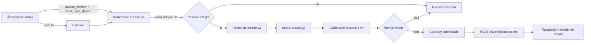
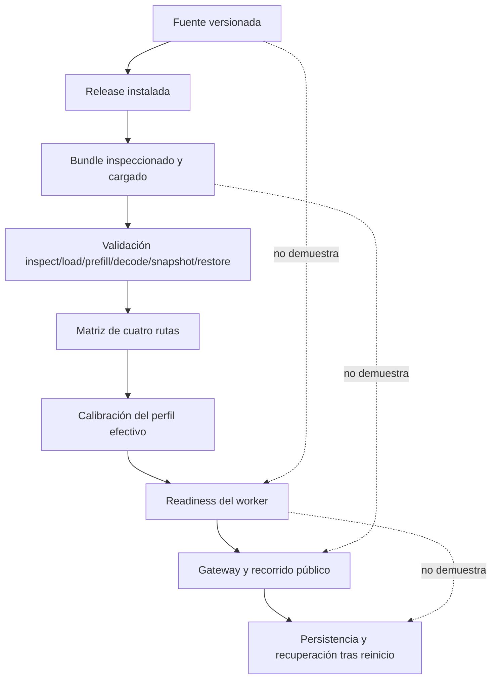
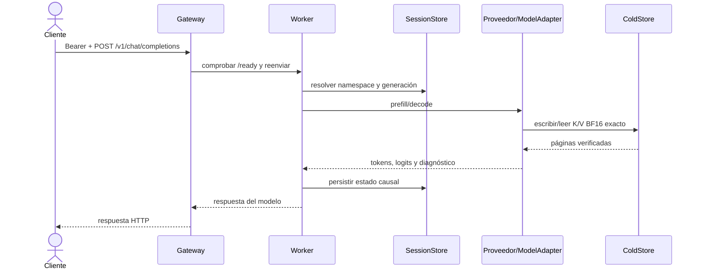
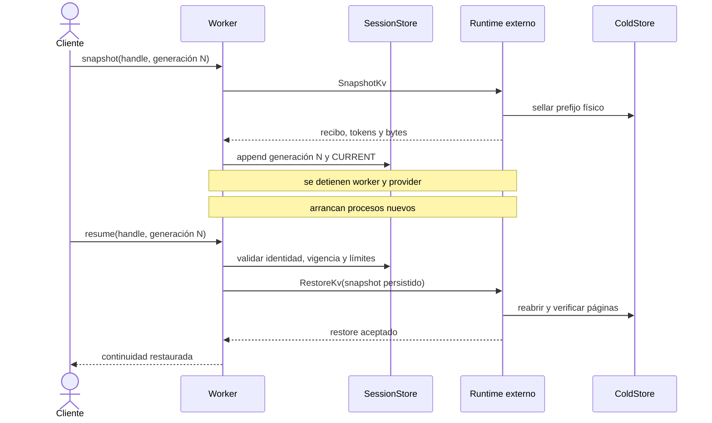
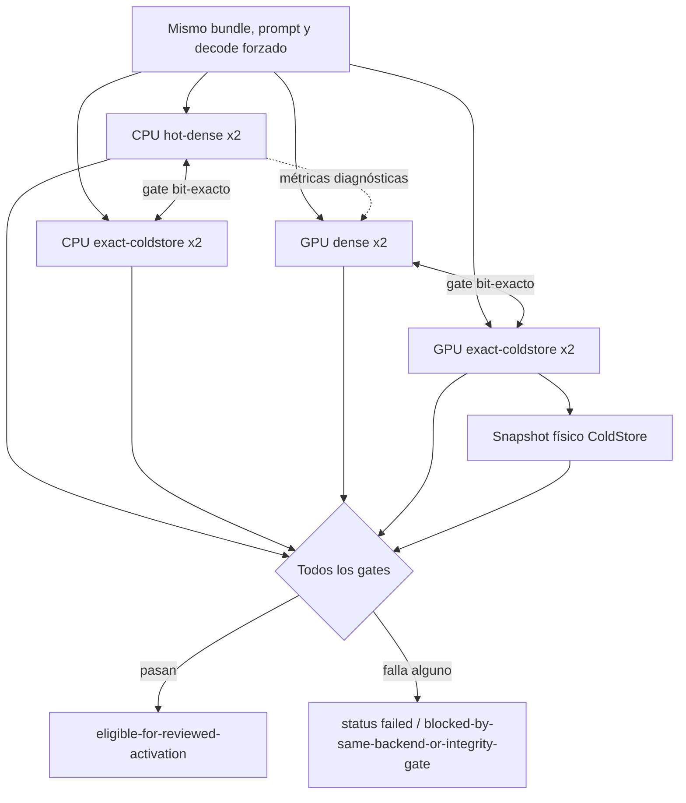
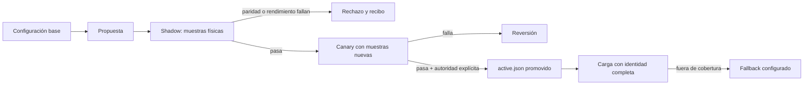

# Arquitectura y flujos verificables de M-SLIM

Este documento es el mapa de navegación del sistema. Distingue código fuente,
artefactos instalados, evidencia local y procesos residentes: ninguna de esas
capas sustituye a las demás. Los recibos de `deploy/local-production/runtime/`
son locales, mutables e ignorados por Git.

## 1. De la fuente a una petición pública

`/health` solo confirma que el proceso vive. `/ready` vuelve a comprobar el
modelo, la revisión fuente, el perfil efectivo y las evidencias exigidas. La
petición autenticada por el gateway es la comprobación de la superficie
pública; no se deduce de un health positivo.

## 2. Autoridad de cada evidencia

| Capa | Demuestra | No demuestra por sí sola |
|---|---|---|
| Fuente | implementación y contratos versionados | binario instalado o proceso residente |
| Release | identidad de inputs y binarios instalados | carga física del modelo |
| Recibo de bundle | operaciones del adapter concreto | paridad entre rutas |
| Matriz | exactitud densa/ColdStore por backend | calidad general o restore |
| Calibración | medición sostenida del perfil congelado | servicio activo |
| `/ready` | aptitud local en ese instante | recorrido público o recuperación |
| E2E | comportamiento del recorrido ejecutado | otros hosts, modelos o revisiones |

## 3. Petición de chat

El gateway autentica la entrada; el worker valida evidencia y transiciones; el
runtime ejecuta; `ColdStore` conserva el K/V físico; `SessionStore` conserva
identidad, generaciones y referencias. Ninguna capa debe asumir la autoridad
de otra.

## 4. Continuidad tras reinicio total

El E2E reinicia ambos procesos. Por eso la recuperación no puede depender de la
RAM del proveedor anterior. `release` escribe una lápida durable: el mismo
handle no vuelve a ser restaurable, tampoco después de otro reinicio.

## 5. Matriz de validación

Cada ruta debe ser determinista frente a su repetición. El gate de integridad
compara densa y exacta dentro del mismo backend. CPU/GPU puede diferir
numéricamente y se conserva solo como diagnóstico.

## 6. Calibración adaptativa

El predictor ordena candidatos, pero no activa nada. Shadow y canary miden el
motor físico; una promoción requiere autoridad explícita y queda ligada a
modelo, tokenizer, backend, hardware, implementación y configuración.

## Lectura siguiente

- [Validación exacta](VALIDATION.md)
- [Continuidad y propiedad](CONTINUITY_LIFECYCLE.md)
- [Adaptadores](MODEL_ADAPTERS.md)
- [Calibración adaptativa](ADAPTIVE_CALIBRATION.md)
- [Instalación local](../deploy/local-production/README.md)
