# Gobierno y evidencia en GitHub

GitHub organiza el trabajo y conserva evidencia; no sustituye la certificación
física del runtime. Esta política mantiene separados los estados de fuente,
build, instalación, proceso residente, efecto autorizado, persistencia y
recuperación posterior al reinicio.

## Cadena de autoridad

```mermaid
flowchart LR
    M[Meta / Milestone] --> I[Issue con aceptación]
    I --> P[Pull Request]
    P --> C[CI: core, seguridad, dependencias]
    C --> A[Artefacto + manifest de hashes]
    A --> T[Atestación GitHub/Sigstore]
    T --> R[GitHub Release]
    R --> V[Verificación de instalación]
    V --> E[E2E autorizado + efecto]
    E --> D[Persistencia + readback]
    D --> X[Reinicio + recuperación]
```



Cada enlace demuestra algo distinto. Una atestación de build vincula un
artefacto con repositorio, workflow y commit, pero no demuestra que ese
artefacto esté instalado o residente, ni que el modelo, backend o estado
persistente sean correctos.

## Controles versionados

| Superficie | Finalidad | Límite |
|---|---|---|
| `M-SLIM / core` | Gate reproducible de formato, lint, tests, contratos e inventario | No usa modelo o hardware físico |
| `Security evidence / CodeQL` | Análisis de Rust y workflows de Actions | Análisis estático, no explotación runtime |
| `Dependency review` | Bloquea nuevas dependencias vulnerables desde severidad moderada | Depende del grafo que GitHub pueda resolver |
| `OpenSSF Scorecard` | Señales de postura de cadena de suministro | No certifica ausencia de vulnerabilidades |
| `github-evidence.py` | Hashes, fuente, contexto y límites de cada artefacto | Registra hechos; no amplía el nivel de prueba |
| `Release provenance` | Paquete ligado a fuente, SHA-256, manifest y atestaciones | Build provenance, no readiness productiva |
| Job físico manual | Paridad, restauración física y calibración sobre runner real | Solo el backend/modelo/configuración ejecutados |

Las Actions externas están fijadas por SHA completo. El comentario conserva la
versión humana; el SHA es la autoridad inmutable.

## Project, campos y vistas

El Project `KV-SHEI — Evidencia y preparación para producción` utiliza Issues y
Pull Requests como elementos. Los campos recomendados son:

- **Status:** Backlog, Ready, In progress, Validation, Blocked, Done.
- **Priority:** P0, P1, P2, P3.
- **Area:** Runtime, Gateway, Model, Adapters, K/V, ColdStore, Continuity,
  Retrieval, Validation, Release, Documentation, Repository.
- **Evidence:** Proposed, Source, Focused test, CI gate, Built, Installed,
  Resident, E2E, Persistence, Restart, Attested release.
- **Result:** Not measured, Failed, Partial, Passed.
- **Backend:** General, Native CPU, Accelerator, LibTorch, HIP.
- **Start date**, **Target date**, **Iteration** y **Effort**.

Vistas mínimas:

1. **Executive board:** agrupado por Status y ordenado por Priority.
2. **Evidence matrix:** tabla agrupada por Evidence y Backend.
3. **Production roadmap:** Roadmap por Start/Target y Milestone.
4. **Blocked P0/P1:** filtro de prioridades críticas bloqueadas.
5. **Validation queue:** Status=Validation, agrupado por Area.
6. **Release scope:** filtro por Milestone de la release activa.

Insights mínimos:

- Burn-up histórico: abiertos frente a completados y alcance total.
- Elementos actuales por Status, agrupados por Priority.
- Elementos por Evidence, agrupados por Backend.
- Resultados por Area.
- Esfuerzo por Iteration.

GitHub no expone todas las vistas y gráficos de Projects mediante su API. Los
campos y elementos pueden automatizarse; la disposición visual y determinados
Insights se verifican en la interfaz del Project.

## Milestones y condiciones de cierre

Un Milestone representa una meta o versión, no una simple fecha. Su descripción
debe incluir:

- objetivo y exclusiones;
- configuración/backends cubiertos;
- gates requeridos;
- artefactos y recibos esperados;
- política de rollback;
- evidencia que continuará sin medir.

Cerrar todos sus Issues solo demuestra que el registro de trabajo está cerrado.
La release exige además que sus condiciones observables y recibos sean válidos.

## Verificar una release

Descargue el archivo, su `.sha256` y el manifest `.evidence.json` desde la
release. Compruebe primero el contenido y después su procedencia:

```bash
sha256sum --check mslim-vX.Y.Z-linux-x86_64.tar.gz.sha256
gh attestation verify mslim-vX.Y.Z-linux-x86_64.tar.gz \
  --repo sheilyneural-afk/KV-SHEI
tar -xzf mslim-vX.Y.Z-linux-x86_64.tar.gz
python3 scripts/github-evidence.py verify \
  mslim-vX.Y.Z-linux-x86_64.evidence.json \
  --artifact-root mslim-vX.Y.Z-linux-x86_64
```

La instalación y el runtime requieren después `verify-release.sh`, identidad
del binario residente, matriz/calibración aplicables, petición autenticada,
efecto, persistencia/readback y el reinicio que corresponda.

## Retención y secretos

- Los artefactos ordinarios de CI se retienen 30 días; candidatos de release,
  90 días. Una GitHub Release conserva los entregables publicados.
- Nunca se suben modelos, tokens, secretos, URLs privadas, caches, estado de
  usuario ni el árbol `deploy/local-production/runtime/` completo.
- Los logs físicos se limitan a salidas explícitas y recibos seleccionados.
- Una evidencia fallida se conserva como fallo; no se transforma en éxito ni
  se reemplaza por documentación.
