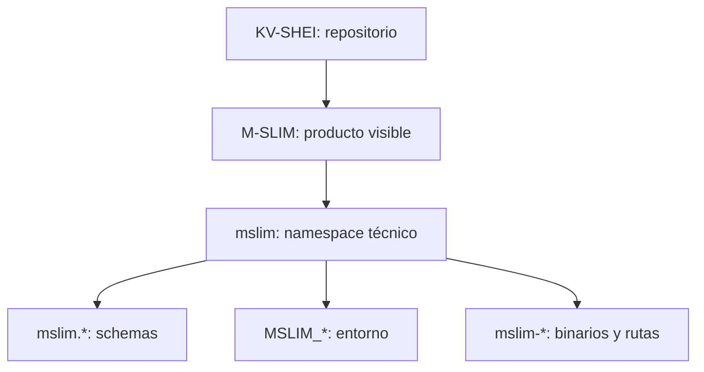

# Estándar de nombres de KV-SHEI

```yaml
project: KV-SHEI
product: M-SLIM
technical_namespace: mslim
```



Estos niveles son deliberados: cambiar un identificador persistente requiere
versionado y migración de consumidores, no una sustitución estética.

## Decisión de identidad

El proyecto tiene tres niveles de identidad y no deben mezclarse:

| Nivel | Nombre | Uso |
|---|---|---|
| Repositorio | `KV-SHEI` | Directorio, repositorio remoto y documentación del proyecto. |
| Producto | `M-SLIM` | Nombre visible del runtime local y de su experiencia de uso. |
| Identificador técnico | `mslim` / `MSLIM_*` | Cargo, crates, binarios, esquemas, rutas internas y variables de entorno. |

`KV-SHEI` no designa un segundo runtime. `M-SLIM` no debe utilizarse como prefijo de
identificadores Rust, nombres de archivos o variables. En código se usa siempre
`mslim` en minúsculas; en Rust, los acrónimos forman una sola palabra (`Mslim`, no
`MSlim`) cuando aparecen en un tipo compuesto.

## Reglas de lenguaje

- Nombrar la responsabilidad implementada, no una intención futura.
- Usar `runtime`, `worker`, `provider`, `gateway`, `store`, `adapter`, `session`,
  `manifest`, `receipt` y `capability` solo cuando el componente ejerce realmente
  esa responsabilidad.
- Evitar `universal`, `intelligent`, `cognitive`, `neural`, `conscious`, `brain`,
  `mind`, `smart` y `canonical` en nombres públicos salvo que exista una
  invariancia demostrable que lo justifique.
- `semantic` queda reservado para estado o contratos que distinguen contenido,
  identidad y generaciones; no es sinónimo de “mejor” o “más avanzado”.
- `memory` describe almacenamiento o continuidad comprobable. No implica memoria
  humana, comprensión, conciencia ni aprendizaje.
- `exact` significa igualdad comprobada bajo el contrato indicado; si solo hay una
  cota o una selección certificada, el nombre debe decir `bounded`, `certified` o
  `approximate`.
- `same-backend exact` significa igualdad contra la referencia densa del mismo
  backend bajo una configuración congelada. No implica igualdad CPU/GPU.
- `passed` describe únicamente los gates incluidos en un recibo. No significa
  que exista una release instalada, un servicio activo o soporte general.
- `eligible-for-reviewed-activation` exige revisión del perfil antes de activar;
  no es una orden de despliegue ni una certificación de producto.
- `canonical` se reserva para la única autoridad efectiva de un dato o efecto.
  No debe usarse como adjetivo de marketing.

## Convenciones técnicas

- Rust: `snake_case` para módulos, funciones, campos y variables; `UpperCamelCase`
  para tipos; `SCREAMING_SNAKE_CASE` para constantes.
- Acrónimos técnicos conservan su forma documental en comentarios (`K/V`, `BF16`,
  `IPC`, `GPU`, `CPU`, `HTTP`), pero en tipos se usa el estilo Rust (`Kv`, `Ipc`
  cuando corresponda).
- Los binarios siguen `<producto>-<responsabilidad>`: por ejemplo,
  `mslim-runtime-worker`, `mslim-runtime-host` y `mslim-gateway`.
- Las features nombran una capacidad de compilación (`native-cpu-backend`,
  `accelerator-backend`, `model-catalog`), no una promesa de disponibilidad.
- Los schemas y variables de entorno son interfaces persistentes y mantienen un
  identificador estable para todos sus consumidores.

## Interfaces y alcance

Los nombres públicos persistentes (`mslim.*`, `MSLIM_*`, binarios y rutas) forman
parte de las interfaces operativas del sistema. Los nombres de algoritmo o
hardware (`OpenCl`, `Torch`, `Hip`, `Gpu`) describen implementaciones concretas y
no representan capacidades generales del núcleo.

## Hallazgos que no se deben ocultar con nombres

- Un `probe`, un manifest o una declaración de capacidades no demuestra por sí
  solo que el runtime esté disponible o que la ruta pública lo utilice.
- Un recibo con un schema distinto del que exige el consumidor no es evidencia
  válida para ese consumidor.
- `ColdStore` y `SessionStore` tienen responsabilidades diferentes y no deben
  fusionarse bajo un nombre genérico como `MemoryStore`.
- `GpuRegionStore` identifica el almacenamiento y la selección de regiones de la
  ruta acelerada; la autoridad de los datos permanece explícita en `ColdStore`.
- `ObservedExtent` representa un tramo
  observado por señales y límites, no una interpretación semántica del contenido.
- `SessionRestore` restaura
  una sesión; la autoridad se verifica en los datos y recibos, no en el nombre.
- `SelectionResult` informa de
  una selección; no implica por sí mismo que sea la autoridad del sistema.
- `M-SLIM — local K/V runtime` identifica el producto visible. La documentación
  funcional describe almacenamiento K/V, continuidad y ejecución local, sin
  atribuir memoria humana ni capacidades cognitivas.
