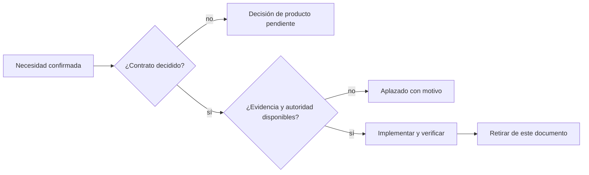

# Trabajo pendiente para producción

Lo que se decidió no hacer todavía, con el motivo. Ninguno de estos puntos está
resuelto en el árbol actual.

Este archivo contiene únicamente trabajo no cerrado. Una capacidad ya
implementada se describe en su documento operativo y aquí permanece solo la
parte que todavía carece de contrato o evidencia.

## Partir los archivos gigantes

`src/gpu_llm/mod.rs` (unas 5.200 líneas) y `src/torch_runtime/kv_cache.rs`
(unas 4.700) concentran gran parte del código y del `unsafe`. Partirlos por
responsabilidades facilitaría la revisión.

Motivo del aplazamiento: `gpu_llm/mod.rs` tiene cambios sin commit de otra
sesión de trabajo, y una refactorización chocaría con ellos. Hacerlo cuando ese
archivo esté confirmado y sin cambios pendientes.

## Elegir el camino único hasta producción

Decisión de producto, no técnica. Propuesta: un modelo en CPU con ColdStore
exacto, empaquetado y ejecutable de principio a fin, con su validación y su
recibo. HIP, instalador, catálogo y router quedarían fuera de ese camino hasta
que el primero esté cerrado.

## Proteger `main` con pull requests obligatorios

Es una configuración del repositorio en GitHub, no de código. Debe exigir que
pase el job `core` del CI (que ejecuta `scripts/check.sh`) antes de fusionar.
Hasta entonces, el hook local `scripts/install-hooks.sh` es la única barrera.

## Semántica real en la recuperación documental

El canal por raíces y la retroalimentación de pseudo-relevancia ya existen y
están medidos en `docs/RETRIEVAL_EVALUATION.md`. Las raíces mejoran flexiones,
pero no relacionan sinónimos reales como "tarjeta gráfica" y "GPU"; la
retroalimentación permanece desactivada porque no mejoró de forma estable.

Queda por diseñar y medir un canal semántico con un modelo propio o un
diccionario versionado, sin convertir texto derivado en autoridad ni introducir
una dependencia de red. Antes de activarlo necesita un conjunto etiquetado más
amplio, medidas de latencia y una política explícita de fallback.
