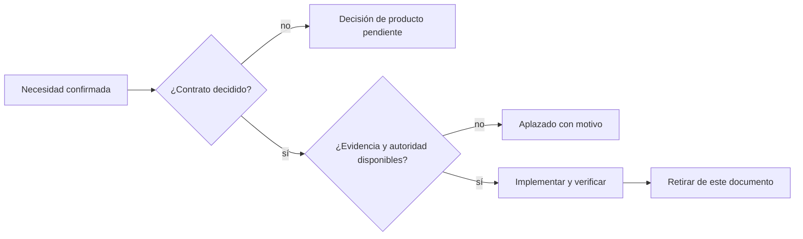

# Trabajo pendiente para producción

> **Fuente canónica:** este archivo vive en el repositorio y la página homónima
> de la wiki se genera automáticamente desde él. No edite la wiki directamente:
> la siguiente regeneración reemplazará esos cambios.

Los [Issues de GitHub](https://github.com/sheilyneural-afk/KV-SHEI/issues)
gestionan estado, prioridad, discusión y cierre. Este documento conserva el
resumen técnico versionado de los trabajos abiertos que afectan a producción.
Un punto se retira aquí en el mismo pull request que satisface sus condiciones
de aceptación; el issue se cierra al fusionarlo mediante `Closes #N`.

Este archivo contiene únicamente trabajo no cerrado. Una capacidad ya
implementada se describe en su documento operativo y aquí permanece solo la
parte que todavía carece de contrato o evidencia. El issue contiene el detalle
operativo; este índice no lo duplica.

## [Partir los archivos gigantes](https://github.com/sheilyneural-afk/KV-SHEI/issues/11)

`src/gpu_llm/mod.rs` (unas 5.600 líneas) y `src/torch_runtime/kv_cache.rs`
(unas 4.700) concentran gran parte del código. Partirlos por
responsabilidades facilitaría la revisión. El `unsafe` está más repartido: los
archivos con más bloques son `src/gpu_llm/gpu_resources.rs`, `src/native_hip.rs`,
`src/gpu_llm/mod.rs`, `src/gpu_llm/prefill.rs` y `src/gpu_backend.rs`.

Motivo del aplazamiento: la refactorización debe hacerse sobre un árbol sin
cambios pendientes en esos archivos y volver a pasar la matriz física de
paridad, porque `gpu_llm/mod.rs` contiene la ruta de inferencia validada.

Seguimiento y condiciones de cierre: [issue #11](https://github.com/sheilyneural-afk/KV-SHEI/issues/11).

## [Elegir el camino único hasta producción](https://github.com/sheilyneural-afk/KV-SHEI/issues/12)

Decisión de producto, no técnica. Propuesta: un modelo en CPU con ColdStore
exacto, empaquetado y ejecutable de principio a fin, con su validación y su
recibo. HIP, instalador, catálogo y router quedarían fuera de ese camino hasta
que el primero esté cerrado.

La decisión duradera debe registrarse en un ADR versionado. Seguimiento y
condiciones de cierre: [issue #12](https://github.com/sheilyneural-afk/KV-SHEI/issues/12).

## [Semántica real en la recuperación documental](https://github.com/sheilyneural-afk/KV-SHEI/issues/14)

El canal por raíces y la retroalimentación de pseudo-relevancia ya existen y
están medidos en `docs/RETRIEVAL_EVALUATION.md`. Las raíces mejoran flexiones,
pero no relacionan sinónimos reales como "tarjeta gráfica" y "GPU"; la
retroalimentación permanece desactivada porque no mejoró de forma estable.

Queda por diseñar y medir un canal semántico con un modelo propio o un
diccionario versionado, sin convertir texto derivado en autoridad ni introducir
una dependencia de red. Antes de activarlo necesita un conjunto etiquetado más
amplio, medidas de latencia y una política explícita de fallback.

Seguimiento y condiciones de cierre: [issue #14](https://github.com/sheilyneural-afk/KV-SHEI/issues/14).
