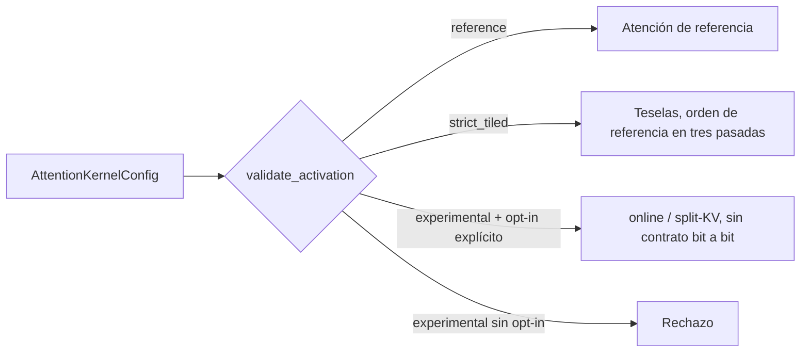

# Atención por teselas (opcional)

La ruta GPU tiene, además de la atención de referencia, una familia de kernels
de atención por teselas (`assets/tiled_attention.cl`,
`src/gpu_llm/tiled_attention.rs`). Comparten contexto, buffers y ColdStore con
el motor existente. No se activan nunca solos: el modo por defecto sigue siendo
`reference`.

## Modos y contrato numérico

| Modo | Contrato | Activación |
|---|---|---|
| `reference` | Ruta original. No admite parámetros distintos de los por defecto. | Por defecto. |
| `strict_tiled` | `reference_order_three_pass`: recalcula QK tres veces para conservar el orden de operaciones de la referencia; bits iguales a la referencia. | Opt-in explícito o perfil de calibración. |
| `online_experimental` | `experimental_online_not_bitwise`: softmax online tipo FlashAttention; no conserva los bits. | Solo con opt-in experimental. Nunca en perfiles. |
| `split_kv_experimental` | Igual que el anterior; divide la historia K/V en varias partes. | Solo con opt-in experimental. Nunca en perfiles. |

Parámetros (`src/attention_kernel.rs`):

| Campo | Valores |
|---|---|
| `block_queries` | 1, 2 o 4 |
| `block_keys` | 32, 64 o 128 |
| `work_group` | 32, 64 o 128 |
| `splits` | 1; solo `split_kv_experimental` admite 2..64 y exige `block_queries = 1` |

## Cómo se activa

- CLI: `--attention-kernel-json '<JSON>'` (máximo 4 KiB). Los modos
  experimentales exigen además `--allow-experimental-attention`.
- ModelAdapter: `mslim_attention_kernel` y, para los experimentales,
  `mslim_allow_experimental_attention: true`.
- Calibración: `mslim-calibrate --tune-prefill --kernel-candidates-json` puede
  medir y proponer configuraciones `strict_tiled`; nunca experimentales. Véase
  [ADAPTIVE_CALIBRATION.md](ADAPTIVE_CALIBRATION.md).

El cambio de kernel exige una sesión vacía y sana, se rechaza con un perfil
calibrado ya adjunto, con `epsilon > 0` y con el puente HIP, y descarta el
replay de prompt (otro esquema de reducción no se acepta como reutilización
exacta). Una vez instalado, sustituye a la atención del motor en prefill y en
decode. La decodificación cuya V no está residente en la GPU (V leída de
ColdStore) sigue usando la ruta de atención verificada original.

## Evidencia registrada

[`docs/validation/tiled-attention.json`](validation/tiled-attention.json)
(schema `mslim.tiled-attention.validation/v1`, 31 de octubre de 2026, AMD
Radeon Phoenix, OpenCL C 1.2) registra:

- puerta compartida en verde (212, 221 y 239 tests según conjunto de features,
  más 4 del crate de API);
- 6 tests físicos: 120 comparaciones `strict_tiled` bit a bit con historias de
  hasta 4097 tokens; 48 comparaciones experimentales con error absoluto máximo
  0,001953125 (tolerancia del test 0,0078125);
- modelo completo Llama 8B BF16 con contextos 8, 17 y 65 y 3 tokens nuevos:
  logits y K/V iguales;
- calibración real con contextos 8/16/24: paridad correcta pero
  `no_candidate_passed` por las puertas de throughput y latencia; no se
  promovió ningún perfil y se restauró la configuración original.

Tiempos de atención aislada (mediana por llamada, geometría del modelo):

| Historia | Consultas | `reference` | `strict_tiled` | `online_experimental` | `split_kv_experimental` |
|---:|---:|---:|---:|---:|---:|
| 1024 | 1 | 2,97 ms | 6,09 ms | 3,69 ms | 3,22 ms |
| 1024 | 16 | 9,75 ms | 40,32 ms | 14,55 ms | 23,30 ms |
| 4096 | 1 | 39,90 ms | 44,47 ms | 6,07 ms | 5,91 ms |
| 4096 | 8 | 259,32 ms | 175,56 ms | 28,27 ms | 45,83 ms |

Lectura: el modo bit a bit no mejora a la referencia en una consulta; los
modos experimentales sí lo hacen con historias largas, pero no conservan los
bits y por eso no pueden entrar en un perfil.

## Límites declarados

- No es una implementación completa de FlashAttention/FlashDecoding.
- Sin certificación de modelo completo con contexto largo ni afirmación general
  de aceleración.
- El ahorro de memoria de scratch no es una reducción de RAM o VRAM del modelo.
- Una prueba inicial a 8192 tokens provocó un timeout de la cola de cómputo
  AMDGPU con reset del contexto. Se limitó el trabajo por encolado y el alcance
  revalidado llega a 4097 tokens; 8192 no está revalidado.
- Sin validación con LibTorch ni HIP.
