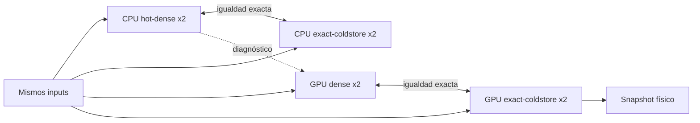

# Contrato de validación de M-SLIM

## Propósito

La validación separa dos preguntas distintas:

1. si la gestión K/V de M-SLIM altera el resultado de un backend concreto;
2. cuánto difieren dos backends físicos distintos al ejecutar el mismo modelo.

La primera pregunta decide la aceptación de la ruta exacta. La segunda es un
diagnóstico numérico y no sustituye la comprobación de integridad K/V.

## Matriz de cuatro rutas



`mslim-adapter-parity` carga el mismo bundle en cuatro configuraciones:

| Identificador del recibo | Adapter | Configuración relevante |
|---|---|---|
| `cpu-hot-dense` | `native-cpu-runtime` | `native_hot_kv_bytes = u64::MAX` |
| `cpu-exact-coldstore` | `native-cpu-runtime` | `native_hot_kv_bytes = 0` |
| `gpu-dense` | `accelerator-runtime` | `mslim_kv_mode = dense` |
| `gpu-exact-coldstore` | `accelerator-runtime` | `mslim_kv_mode = exact-coldstore` y directorio físico temporal |

La configuración común fija `epsilon = 0` y desactiva replay de prompt,
prefijo compartido, commit diferido y unroll4. Activa los kernels fusionados que
figuran en `frozen_runtime_configuration` del recibo. El recibo, no este texto,
es la autoridad sobre los valores exactos usados en una ejecución.

## Orden de comprobación

### 1. Determinismo por ruta

Cada ruta ejecuta dos veces el mismo prefill y la misma secuencia de decode
forzado. Tras la primera ejecución se llama a `reset_session`. Para pasar, las
dos ejecuciones deben conservar exactamente:

- logits de prefill y de cada paso;
- token predicho en cada paso;
- SHA-256 de la serialización lógica K/V.

Si una ruta física no fuera determinista por naturaleza, esta versión de la
matriz no la aprobaría. Todavía no existe un modo estadístico de aceptación para
backends no deterministas.

### 2. Exactitud dentro del mismo backend

Se comparan:

- CPU hot-dense con CPU ColdStore exacto;
- GPU densa con GPU ColdStore exacto.

El gate `exact_same_backend_passed` exige simultáneamente:

- logits bit-exactos;
- tokens iguales;
- SHA-256 lógico de K/V igual.

En CPU, “hot-dense” describe la fuente usada por la atención; ColdStore sigue
siendo la representación persistente canónica. En GPU, la ruta densa usa K/V de
dispositivo y la ruta exacta utiliza ColdStore.

### 3. Contrato de snapshot físico

La ruta GPU exacta debe emitir un snapshot con:

```text
schema    = mslim.runtime.physical-coldstore-snapshot/v1
authority = canonical-bf16-coldstore
```

La comprobación asegura que no se aceptó por error un snapshot lógico de replay
como si fuera el estado físico de ColdStore.

El handle conserva además el `last_argmax` autoritativo para reanudar una ruta
token-only sin copiar logits completos. Al leer handles anteriores, el runtime
puede derivarlo de `last_logits`; si no existe ninguna de las dos evidencias,
la reutilización exacta del prefijo falla cerrada.

### 4. Diagnóstico CPU/GPU

Se compara CPU hot-dense con GPU densa usando las mismas entradas. Se registran:

- máximo, media y p95 de la diferencia absoluta de logits;
- KL de la distribución CPU hacia GPU;
- top-1 y margen top-1/top-2 de cada backend;
- igualdad de tokens;
- proximidad a una ULP BF16 como dato histórico de diagnóstico.

Ni la igualdad bit a bit ni una ULP BF16 forman parte del gate de activación.
Los backends pueden cambiar el orden de reducción, la fusión y la precisión de
operaciones sin que ColdStore sea la causa de la diferencia.

## Serialización lógica K/V

Los adapters exponen `logical_kv_sha256` sobre esta secuencia canónica:

```text
K seguido de V; orden layer-major, head, token, dim
```

El digest permite comparar contenido lógico aunque el layout físico sea
distinto. No demuestra por sí solo que dos backends hayan calculado el mismo K/V;
de hecho, CPU y GPU pueden producir digests distintos. Su función principal es
comprobar la ruta densa frente a la exacta dentro del mismo backend.

## Significado del estado

`status = passed` requiere:

- las cuatro rutas deterministas;
- las dos comparaciones same-backend exactas;
- snapshot físico válido en la ruta GPU exacta.

Si falta cualquiera de las tres condiciones, el recibo registra
`status = failed` y `activation = blocked-by-same-backend-or-integrity-gate`.

`activation = eligible-for-reviewed-activation` no arranca servicios, no instala
binarios y no aprueba otra configuración. Indica únicamente que la ejecución
incluida en el recibo superó esos gates.

La matriz llama a `snapshot_kv`, pero no restaura ese snapshot. El restore se
valida en la conformidad del adapter y en los E2E de continuidad. La matriz
incluye `source_revision`; los consumidores de activación exigen que sea el
commit exacto del binario actual y que el árbol estuviera limpio al compilarlo.

La calibración sostenida añade una segunda ligadura, distinta de la matriz:
`frozen_runtime_configuration` registra la configuración física con la que se
midieron prefill y decode. Incluye ColdStore, modo de pesos, contexto máximo,
epsilon, capacidades hot/replay y los switches de kernel. El worker publica el
mismo objeto como `worker_capabilities.effective_configuration`; tanto el
worker como el gateway exigen igualdad completa antes de admitir readiness.
Así, una medición `stream` no autoriza un worker `resident`, ni una calibración
de 8192 tokens autoriza por accidente un proceso configurado para 32768.

La v5 liga además la medición al entorno físico mediante
`calibration_environment.device_key`. La huella cubre el dispositivo y vendor
seleccionados, las versiones de driver/runtime OpenCL, el shader y sus opciones
de compilación, sin almacenar hostname, usuario ni identificadores de máquina.
El worker obtiene esa huella del `GpuEngine` que mantiene el modelo cargado
—no de un segundo sondeo— y el gateway repite la comparación contra el recibo.
La matriz exige además que sus rutas GPU densa y ColdStore publiquen la misma
huella cargada. Una calibración copiada desde otra GPU o driver queda rechazada
aunque coincidan bundle, fuente y configuración.

La matriz v2 lleva el mismo `calibration_environment`. El calibrador solo la
acepta si coincide con su dispositivo efectivo y registra el SHA-256 de los
bytes exactos de la matriz como `validation_matrix_sha256`. El worker recalcula
ese digest desde el archivo que publica y el gateway comprueba de nuevo la
relación. Así, sustituir la matriz después de calibrar o encadenar matriz y
calibración de máquinas distintas invalida readiness.

Los perfiles promovidos de prefill no están cubiertos por la calibración v5:
si el worker activa uno, su identidad efectiva deja de coincidir y readiness
falla cerrada. Para admitirlos habrá que ampliar el productor de calibración y
versionar el contrato con la identidad concreta del perfil. La matriz y el
calibrador eliminan también cualquier kernel de atención experimental heredado
del `config.json`; una ruta así necesita evidencia explícita, no una activación
implícita bajo la identidad de la ruta canónica.

## Evidencia histórica

Esta sección conserva una medición fechada como contexto, no como evidencia
vigente del `HEAD`. La evidencia actual debe regenerarse desde un árbol limpio.

Una ejecución local anterior para el bundle
`43e8fa4641e6f06d9df96abc4ef285556a8c714af6909b13e22e01e723d3d686`
pasó los gates anteriores con ocho pasos de decode. El SHA-256 de aquel recibo fue
`8afd03f87d0c842788f33e86c3e45ff8343aeee974a9049e3b849a8d2d7e3344`.

En esa ejecución, la comparación CPU/GPU conservó top-1 y tokens, pero no
logits ni K/V bit-exactos. El máximo absoluto observado fue `0.234375`. Es una
muestra pequeña y no constituye un umbral de producto. La evidencia vigente
debe leerse del recibo local y coincidir con la revisión fuente actual.

## Aproximación

La matriz fija `epsilon = 0`. No mide una política con descarte. Para autorizar
`epsilon > 0` hace falta una evaluación separada que incluya, como mínimo:

- referencia densa del mismo backend;
- KL, p95 y cambios top-1 en un corpus representativo;
- perplexidad o métrica de tarea adecuada;
- generaciones suficientemente largas para observar acumulación de error;
- memoria realmente evitada y latencia;
- comportamiento del fallback cuando no existe certificado de descarte.

Hasta que exista esa evidencia, `epsilon > 0` debe permanecer desactivado.

## Retención de evidencia

El proyecto conserva únicamente la matriz más reciente. Las calibraciones,
certificaciones, E2E y comparaciones anteriores se eliminan cuando una nueva
ejecución pasa a ser la referencia vigente. Los nuevos recibos no deben mezclar
schemas ni reutilizar resultados de una revisión anterior.
